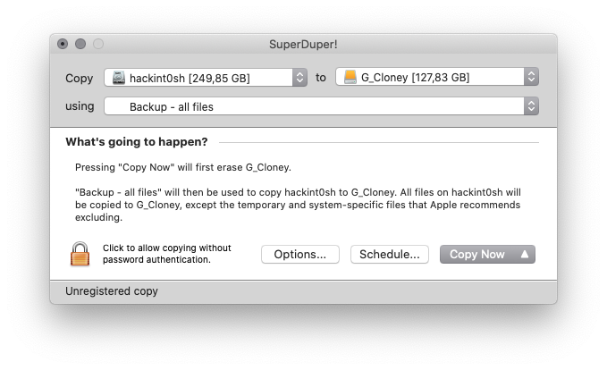

# A bootable clone

First of all, this is not a backup solution, but it also is a backup solution. A rule of thumb when it comes to backups is that if your data doesn't exist in 3 different places, one of which is in another location, it is not really backed up.

But, for our purposes -- hackintoshing -- it is pretty much essential to have a clone of your working system. Not only does it allow you to use its EFI to boot your internal disk in case the EFI on there gets messed up, but in a case of drive failure you can boot into your clone and resume work as if nothing happened and/or clone it to a new drive.

There are several ways to clone your system. The most used options are paid apps:
* [Carbon Copy Cloner](https://bombich.com) - More fancy, should be reliable but I don't like it. Too bloated for me.
* [SuperDuper!](https://www.shirt-pocket.com/SuperDuper/) - Minimalistic, stable and reliable.

As a minimalist I am a fan of the latter. It is also the only one of the two that has a fully functional free version whereas Carbon Copy Cloner only has a 30 day trial.

You can also use something like [Clonezilla](https://clonezilla.org) and others like it. I will be sticking with SuperDuper! for this little guide.

The free version of SuperDuper! is only limited when it comes to updating existing clones and some advanced options. So updating a clone is going to take just as long as creating it. This shouldn't be an issue if you keep your data on another partition or disk.

First we'll format your backup medium. SuperDuper! will erase it again by default but I'm not sure if it will create a missing EFI partition. So to be safe I format it manually before a fresh clone. I suggest using an SSD in a USB 3 case or a (very) fast USB 3 stick. Anything too slow will be frustrating to use once you've booted into it.

Format it APFS with a GUID partition layout. Open SuperDuper! and in the main window on the left select your macOS disk and on the right select your destination disk. Click copy now, enter password, etc and you're on your way.

Once this is done mount the EFI partitions of your internal and destination disk and copy the EFI folder from the internal disk to the destination so it can boot.

::: info Note
Do test if your backup works. Don't assume it will work.
:::

That's all!
